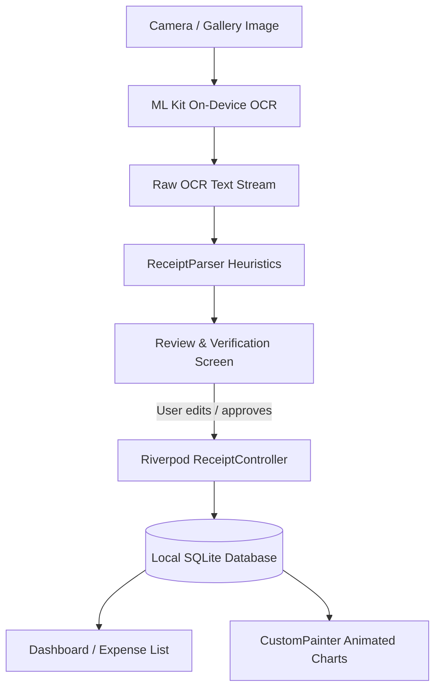

# VKU Expense OCR — Mini-Project 3: Receipt OCR & Expense Tracker

> **Vietnam - Korea University of Information and Communication Technology (VKU)**  
> **Course:** Mobile Application Development with Flutter (Weeks 7 & 8)  
> **Project:** Mini-Project 3 — Receipt OCR & Expense Tracker  

---

## 📖 Overview

**VKU Expense OCR** is a production-grade Flutter application designed for scanning Vietnamese retail and restaurant receipts, extracting receipt details on-device using Google ML Kit Text Recognition, parsing messy OCR text with Vietnamese regex heuristics, providing a mandatory review and verification workflow, persisting records in local SQLite, and visualizing financial insights with custom-painted animated charts.

The app strictly follows modern Flutter software engineering practices, incorporating **Material 3**, **Riverpod 2 (Notifier / AsyncNotifier)** architecture, declarative **GoRouter**, local **SQLite (sqflite)** persistence, and platform channels (**MethodChannel**).

---

## 🚀 Key Features

1. **Receipt Camera & Gallery OCR Capture**:
   - On-device text recognition with **Google ML Kit Text Recognition**.
   - Zero cloud dependencies or latency; processes images entirely on the client.
   - Smooth progress indicator and error recovery for poor-quality scans.

2. **Vietnamese Receipt Heuristic Parser (`ReceiptParser`)**:
   - Extracts merchant names, eliminating headers such as "HÓA ĐƠN BÁN HÀNG", "PHIẾU THANH TOÁN", order numbers, or tax codes.
   - Matches Vietnamese keywords: `TỔNG TIỀN`, `TỔNG CỘNG`, `THANH TOÁN`, `TIỀN MẶT`, `CỘNG TIỀN HÀNG`, `TOTAL`, `AMOUNT DUE`.
   - Normalizes currency separators (`65.000`, `120,000`, `1.250.000 đ`).
   - Automatically parses multiple date formats (`dd/MM/yyyy`, `dd-MM-yyyy`, `yyyy-MM-dd`).
   - Auto-categorizes expenses (Ăn uống, Mua sắm, Di chuyển, Hóa đơn, Giải trí, Sức khỏe, Khác).
   - Generates confidence score and preserves raw OCR text for debugging.

3. **Mandatory Review & Verification Screen**:
   - Because receipt OCR is naturally noisy, users review extracted fields before persisting to SQLite.
   - Form validation: Required merchant name, positive numeric total amount, valid date.
   - Expandable raw OCR text viewer for full transparency.

4. **Manual Expense Entry**:
   - Allows manual entry when no receipt photo is available or OCR fails.
   - Reuses identical domain models and database repositories.

5. **Local SQLite Persistence (`sqflite`)**:
   - Full CRUD: Create, Read, Update, Delete.
   - Category and weekly aggregations.
   - Data persists across app restarts without data loss.

6. **Animated CustomPainter Charts (No third-party chart libraries)**:
   - **Category Donut Chart (`DonutChartPainter`)**: Animated sweep angles, inner hole with total spending, interactive color-coded category legends.
   - **7-Day Spending Bar Chart (`WeeklyBarChartPainter`)**: Animated vertical bars, horizontal grid lines, daily amount labels, and weekday badges.

7. **Material 3 UI & Dark Mode**:
   - Curated Deep Teal palette (`Color(0xFF00695C)`).
   - Persistent theme toggle (Light / Dark / System) with `SharedPreferences` persistence.
   - Fully responsive layout with safe padding, empty states, and loading states.
   - Reusable `ExpenseSummaryCard` following Week 7 specifications.

8. **Platform Channel Integration (Week 8 Demonstration)**:
   - Native Kotlin `MethodChannel` (`vn.edu.vku/device_info`) exposing real device battery percentage and hardware model.

---

## 🛠️ Technology Stack

| Layer | Technology |
|---|---|
| **Framework** | Flutter 3.47+ / Dart 3.13+ |
| **Design System** | Material 3 (`useMaterial3: true`) |
| **State Management** | Riverpod 2 / 3 (`AsyncNotifier`, `NotifierProvider`, `ref.watch`, `ref.read`) |
| **Navigation** | GoRouter 18 (`StatefulShellRoute`, persistent bottom navigation) |
| **Database** | SQLite via `sqflite` + `sqflite_common_ffi` (Desktop fallback) |
| **OCR Engine** | Google ML Kit Text Recognition (`google_mlkit_text_recognition`) |
| **Media Picking** | `image_picker` (Camera & Gallery) |
| **Localization / Currency** | `intl` (Vietnamese Dong formatting `#,### đ`) |
| **Charts** | Flutter `CustomPainter` + `AnimationController` |
| **Native Channel** | Android `MethodChannel` (`vn.edu.vku/device_info`) |

---

## 📐 Architecture

The application adopts Clean Architecture separation of concerns:

```
lib/
├── core/
│   ├── constants/
│   │   ├── app_constants.dart      # Category definitions, icons, colors
│   │   └── app_theme.dart          # Light and Dark Material 3 theme configurations
│   ├── parsers/
│   │   └── receipt_parser.dart     # Heuristic regex-based receipt text parser
│   └── utils/
│       ├── currency_formatter.dart # Vietnamese currency formatting and parser
│       └── date_formatter.dart     # Date formatting and parser
├── models/
│   ├── category_expense.dart       # Category aggregation model
│   ├── daily_expense.dart          # Daily aggregation model for 7-day chart
│   └── receipt.dart                # Main Receipt domain entity
├── painters/
│   ├── donut_chart_painter.dart    # CustomPainter for animated category donut chart
│   └── weekly_bar_chart_painter.dart # CustomPainter for 7-day bar chart
├── repositories/
│   └── receipt_repository.dart     # Repository interface and SQLite implementation
├── router/
│   └── app_router.dart             # GoRouter configuration & route hierarchy
├── screens/
│   ├── add_expense_screen.dart     # Manual expense entry with validation
│   ├── dashboard_screen.dart       # Primary dashboard with stats, cards, filters
│   ├── main_scaffold_screen.dart   # Shell scaffold with persistent NavigationBar
│   ├── receipt_detail_screen.dart  # Receipt detail, inline edit, delete confirmation
│   ├── reports_screen.dart         # Analytics, custom charts, platform channel demo
│   ├── review_screen.dart          # Mandatory OCR review & verification form
│   └── scan_screen.dart            # Camera/gallery OCR trigger and preview
├── services/
│   ├── database_service.dart       # SQLite database helper, tables, queries
│   ├── ocr_service.dart            # ML Kit text recognition service wrapper
│   └── platform_channel_service.dart # Android MethodChannel service
├── state/
│   ├── receipt_controller.dart     # AsyncNotifier controller for CRUD actions
│   ├── receipt_providers.dart      # Providers for stats, filters, chart breakdowns
│   └── theme_provider.dart         # Theme mode notifier with persistent storage
├── widgets/
│   ├── charts/
│   │   ├── category_donut_chart.dart # Donut chart widget with AnimationController
│   │   └── weekly_bar_chart.dart     # Bar chart widget with AnimationController
│   ├── empty_state.dart            # Polished empty state with action buttons
│   ├── expense_summary_card.dart   # Week 7 reusable expense summary card
│   ├── loading_view.dart           # Loading progress indicator
│   └── stats_metric_card.dart      # Dashboard metric indicator card
└── main.dart                       # Entry point, ProviderScope, routerConfig
```

---

## 📷 OCR & Processing Pipeline



---

## 🗄️ Database Schema

Table name: `receipts`

| Column | Type | Constraints | Description |
|---|---|---|---|
| `id` | `INTEGER` | `PRIMARY KEY AUTOINCREMENT` | Unique receipt identifier |
| `merchant_name` | `TEXT` | `NOT NULL` | Store or merchant name |
| `amount` | `REAL` | `NOT NULL` | Expense total in VNĐ |
| `date` | `TEXT` | `NOT NULL` | ISO8601 transaction date |
| `category` | `TEXT` | `NOT NULL` | Category name (e.g. Ăn uống, Mua sắm) |
| `image_path` | `TEXT` | `NULLABLE` | Local path to receipt image |
| `raw_ocr_text` | `TEXT` | `NULLABLE` | Raw OCR output for audit / verification |
| `note` | `TEXT` | `NULLABLE` | User-defined note |
| `created_at` | `TEXT` | `NOT NULL` | Record creation timestamp |
| `updated_at` | `TEXT` | `NOT NULL` | Record update timestamp |

---

## 🚀 Setup & Execution Guide

### Prerequisites
- Flutter SDK (v3.24+ or v3.47+)
- Dart SDK (v3.5+ or v3.13+)
- Android Studio / Android SDK (API 21+)
- Java JDK 17 or 21

### 1. Clone Repository & Install Dependencies
```bash
git clone <repository_url>
cd vku_expense_ocr
flutter pub get
```

### 2. Run Analyzer & Automated Tests
```bash
# Verify static analysis (0 warnings, 0 errors)
flutter analyze

# Run unit and widget test suite
flutter test
```

### 3. Run Locally (Desktop / Android Device / Emulator)
```bash
# Run on connected Android device
flutter run -d android

# Or run on Windows desktop (with SQLite FFI fallback)
flutter run -d windows
```

### 4. Build Release APK
```bash
flutter build apk --release
```
The output APK is generated at:
`build/app/outputs/flutter-apk/app-release.apk`

---

## 📱 Testing OCR on a Physical Android Phone

1. Enable **Developer Options** and **USB Debugging** on your phone.
2. Connect your phone via USB and run:
   ```bash
   flutter run -d <your-device-id>
   ```
3. Open the **Quét hóa đơn** (Scan) tab.
4. Point your camera at a real Vietnamese receipt (e.g., Highlands Coffee, WinMart, Phúc Long, Circle K, Grab) or choose a sample image from Gallery.
5. Watch the OCR detect the store name, grand total, and transaction date in real-time.
6. The **Review & Verification** screen allows adjusting any field before saving to SQLite.
7. Open **Báo cáo** (Reports) to see the animated donut chart and weekly bar chart immediately update!

---

## ⚠️ Known Limitations & Future Work

- **Handwritten Receipts**: ML Kit Latin model performs best on printed receipts; handwritten notes may yield lower confidence.
- **Complex Multi-Item Splitting**: The current pipeline focuses on the grand total, merchant, date, and category. Itemized line-item extraction can be expanded in future versions.
- **Desktop/Web Platform Channel**: Battery level MethodChannel is implemented specifically for Android (`vn.edu.vku/device_info`). On desktop/web, it gracefully reports that the native channel is Android-specific.

---

## 📄 License & Credits
Developed for **Mini-Project 3** — Mobile Application Development with Flutter, **Vietnam - Korea University of Information and Communication Technology (VKU)**.
