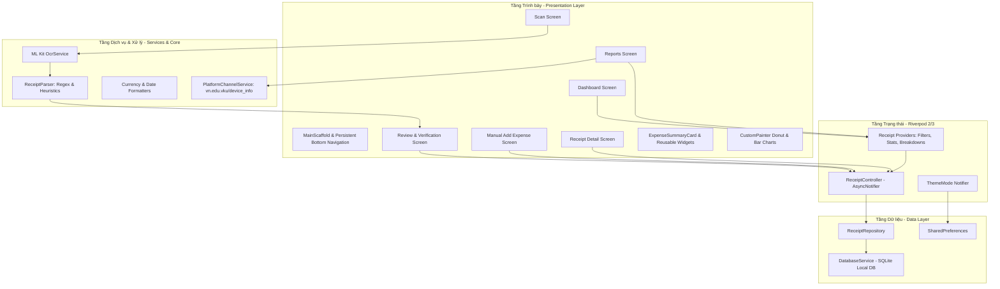

# BÁO CÁO KỸ THUẬT (TECHNICAL REPORT)
## Mini-Project 3: Receipt OCR & Expense Tracker
### Ứng dụng Quản lý Chi tiêu và Quét Hóa đơn Thông minh (VKU Expense OCR)

**Học phần:** Phát triển ứng dụng di động đa nền tảng (9)
**Trường:** Trường Đại học Công nghệ Thông tin và Truyền thông Việt - Hàn (VKU)  
**Họ và Tên:** Võ Xuân Ngọc 
**Mã Sinh Viên:** 23IT180

---

## 1. TỔNG QUAN DỰ ÁN (PROJECT OVERVIEW)

Trong quản lý tài chính cá nhân, việc nhập liệu thủ công từng khoản chi tiêu từ hóa đơn bán lẻ thường tốn thời gian và dễ xảy ra sai sót. **VKU Expense OCR** giải quyết bài toán này bằng cách ứng dụng công nghệ trí tuệ nhân tạo trên thiết bị (**On-Device Optical Character Recognition - OCR**) kết hợp thuật toán phân tích cú pháp biểu thức chính quy (**Regex & Heuristics**) để tự động đọc và trích xuất thông tin hóa đơn tiếng Việt.

### Mục tiêu cốt lõi:
- **Tự động hóa nhập liệu:** Chụp ảnh hóa đơn qua Camera hoặc Thư viện và tự động trích xuất: Tên cửa hàng, Tổng tiền, Ngày giao dịch, Danh mục.
- **Quy trình xác thực an toàn (Review & Verification):** Hóa đơn thực tế thường bị nhàu, mờ hoặc lẫn tạp âm quang học; ứng dụng cung cấp giao diện xem lại bắt buộc trước khi lưu vào cơ sở dữ liệu.
- **Lưu trữ cục bộ an toàn:** Sử dụng SQLite (`sqflite`) để lưu trữ ngoại tuyến, không phụ thuộc máy chủ bên ngoài.
- **Trực quan hóa tài chính chuyên sâu:** Tự vẽ biểu đồ bằng `CustomPainter` (Biểu đồ tròn Donut và Biểu đồ cột 7 ngày), có hoạt ảnh mượt mà.
- **Trải nghiệm hiện đại:** Tuân thủ Material 3, hỗ trợ chuyển đổi chế độ Sáng/Tối (Light/Dark mode) và tích hợp kênh giao tiếp phần cứng Android (`MethodChannel`).

---

## 2. KIẾN TRÚC HỆ THỐNG (SYSTEM ARCHITECTURE)

Ứng dụng được thiết kế theo mô hình phân tầng sạch (**Clean Layered Architecture**), phân tách rõ ràng giữa Tầng Trình bày (Presentation), Tầng Quản lý Trạng thái (State Management), Tầng Dịch vụ (Services), và Tầng Dữ liệu (Data Layer).

### 2.1 Sơ đồ kiến trúc Mermaid



---

## 3. LUỒNG XỬ LÝ OCR & BỘ PHÂN TÍCH HÓA ĐƠN (OCR & PARSER PIPELINE)

### 3.1 Quy trình xử lý ảnh:
1. **Thu nhận ảnh (Image Acquisition):** Sử dụng `image_picker` chụp từ Camera thiết bị hoặc chọn từ Gallery, nén ảnh ở kích thước tối ưu (max 1920x1920, chất lượng 90%).
2. **Nhận diện ký tự quang học (On-Device ML Kit OCR):** Đối tượng `InputImage` được chuyển vào `TextRecognizer(script: TextRecognitionScript.latin)` chạy offline hoàn toàn trên GPU/NPU của thiết bị.
3. **Phân tích cú pháp văn bản (Regex & Heuristic Parsing):** `ReceiptParser.parse()` nhận chuỗi văn bản thô, tách dòng và áp dụng các mẫu biểu thức chính quy chuyên biệt cho hóa đơn bán lẻ tại Việt Nam.
4. **Kiểm tra và xác nhận (Verification):** Giao diện `ReviewScreen` hiển thị các trường đã trích xuất, kèm chỉ số tin cậy (Confidence Score) và vùng xem văn bản thô cho người dùng điều chỉnh trước khi xác nhận lưu.

### 3.2 Bảng biểu thức chính quy (Regex Extraction Table)

| Thành phần trích xuất | Mẫu Regex / Quy tắc Heuristic | Mục đích & Giải thích |
|---|---|---|
| **Tổng tiền (Total Amount)** | `(?i)(tổng\s*tiền\|tong\s*tien\|thanh\s*toán\|thanh\s*toan\|tổng\s*cộng\|total\|amount\s*due)` | Định vị dòng chứa từ khóa thanh toán |
| **Định dạng số VNĐ** | `(?:\d{1,3}(?:[.,]\d{3})+(?:[.,]\d{2})?\|\d{4,})\s*(?:đ\|vnđ\|vnd)?` | Nhận diện số tiền có dấu chấm/phẩy phân cách hàng nghìn (VD: `65.000`, `125,000`, `1.250.000 đ`) |
| **Loại trừ tên cửa hàng** | `(?i)(hóa\s*đơn\|hoa\s*don\|phiếu\|receipt\|mã\s*chuyến\|chuyến\s*đi\|\btax\b\|\btel\b)` | Lọc bỏ tiêu đề hóa đơn, mã chuyến đi, mã số thuế để tránh gán nhầm thành tên cửa hàng |
| **Tên cửa hàng (Merchant)** | Phân tích 5 dòng đầu tiên, loại trừ từ khóa phi thương hiệu, chọn dòng có độ dài 3-50 ký tự hợp lệ | Trích xuất tên chuỗi: Highlands Coffee, WinMart+, Circle K, Grab Taxi, Nhà thuốc Long Châu... |
| **Ngày lập hóa đơn** | `(\d{1,2})[/\.-](\d{1,2})[/\.-](\d{4})` hoặc `(\d{4})[/\.-](\d{1,2})[/\.-](\d{1,2})` | Nhận diện ngày theo định dạng `dd/MM/yyyy`, `dd-MM-yyyy`, `yyyy-MM-dd` |
| **Phân loại tự động** | Đối sánh thương hiệu và mặt hàng (`coffee\|trà sữa\|cơm\|phở` → Ăn uống; `winmart\|siêu thị` → Mua sắm; `grab\|taxi` → Di chuyển; v.v.) | Tự động gắn danh mục chi tiêu chính xác |

---

## 4. CƠ SỞ DỮ LIỆU CỤC BỘ SQLITE (DATABASE SCHEMA)

Ứng dụng sử dụng SQLite thông qua thư viện `sqflite` (và `sqflite_common_ffi` cho môi trường Desktop/Unit Test).

### 4.1 Cấu trúc bảng `receipts`:

```sql
CREATE TABLE receipts (
    id INTEGER PRIMARY KEY AUTOINCREMENT,
    merchant_name TEXT NOT NULL,
    amount REAL NOT NULL,
    date TEXT NOT NULL,
    category TEXT NOT NULL,
    image_path TEXT,
    raw_ocr_text TEXT,
    note TEXT,
    created_at TEXT NOT NULL,
    updated_at TEXT NOT NULL
);

-- Chỉ mục tối ưu hóa tốc độ truy vấn
CREATE INDEX idx_receipts_date ON receipts (date);
CREATE INDEX idx_receipts_category ON receipts (category);
```

### 4.2 Các phương thức truy vấn tối ưu:
- **CRUD:** `insertReceipt()`, `updateReceipt()`, `deleteReceipt()`, `getAllReceipts()`, `getReceiptById()`.
- **Tổng chi tiêu:** `SELECT SUM(amount) as total FROM receipts`.
- **Phân bổ danh mục:** `SELECT category, SUM(amount) as total_amount, COUNT(*) as item_count FROM receipts GROUP BY category ORDER BY total_amount DESC`.
- **Thống kê 7 ngày:** Nhóm dữ liệu theo ngày `SUBSTR(date, 1, 10)` trong khoảng 7 ngày gần nhất để vẽ biểu đồ cột.

---

## 5. QUẢN LÝ TRẠNG THÁI VỚI RIVERPOD (STATE MANAGEMENT)

Ứng dụng áp dụng Riverpod 2 với kiến trúc hướng sự kiện bất đồng bộ:

- **`receiptListProvider` (`AsyncNotifierProvider<ReceiptController, List<Receipt>>`):** Quản lý danh sách hóa đơn theo trạng thái bất đồng bộ (`AsyncLoading`, `AsyncData`, `AsyncError`). Khi người dùng thêm, sửa hoặc xóa hóa đơn, trạng thái nội bộ được cập nhật tức thì và tự động kích hoạt render lại các widget liên quan mà không cần reload toàn trang.
- **`totalExpenseAmountProvider` & `totalReceiptCountProvider`:** Các provider phái sinh (derived providers) tự động tính toán tổng số tiền và số lượng hóa đơn theo thời gian thực.
- **`categoryExpensesBreakdownProvider` & `weeklyExpensesBreakdownProvider`:** Tính toán dữ liệu phần trăm và số tiền hàng ngày cho hai biểu đồ phân tích.
- **`themeModeProvider` (`NotifierProvider<ThemeNotifier, ThemeMode>`):** Quản lý chế độ giao diện sáng/tối và lưu cấu hình vào `SharedPreferences`.

---

## 6. THIẾT KẾ VẼ BIỂU ĐỒ BẰNG CUSTOMPAINTER (CUSTOM CHARTS)

Dự án không phụ thuộc vào thư viện biểu đồ bên thứ ba mà hiện thực trực tiếp bằng canvas của Flutter:

### 6.1 Biểu đồ tròn phân bổ danh mục (`DonutChartPainter`):
- Sử dụng `canvas.drawArc()` tính toán góc quét `sweepAngle = (categoryAmount / total) * 2 * pi * animationProgress`.
- Điểm bắt đầu tại đỉnh 12 giờ (`-pi / 2`).
- Khoảng hở thẩm mỹ (`gap = 0.03 rad`) giữa các phân đoạn.
- Khoảng trống trung tâm (Donut Hole) hiển thị nhãn "Tổng chi" và tổng tiền định dạng tiền Việt.
- Điều khiển bằng `AnimationController` (thời lượng 1200ms, đường cong `Curves.easeOutCubic`).

### 6.2 Biểu đồ cột chi tiêu 7 ngày (`WeeklyBarChartPainter`):
- Tự động co giãn theo trục Y dựa trên giá trị chi tiêu lớn nhất trong tuần `effectiveMax = maxAmount * 1.15`.
- Vẽ các đường lưới ngang chấm mờ (Gridlines).
- Vẽ cột nền track xám nhạt và cột dữ liệu có dải màu Gradient (Teal chuyển sắc).
- Bo tròn góc đỉnh cột (`RRect.fromRectAndCorners`).
- Hiển thị nhãn số tiền dạng thu gọn (`65k`, `1.2M`) trên đỉnh cột và nhãn thứ trong tuần (`T2`, `T3`... `CN`) phía dưới.
- Hiệu ứng xuất hiện mượt mà bằng `Curves.easeOutCubic`.

---

## 7. GIAO DIỆN NGƯỜI DÙNG & MINH HỌA (UI / UX SHOWCASE)

*(Khu vực hình ảnh chụp màn hình ứng dụng)*

| Màn hình Tổng quan (Dashboard) | Quét hóa đơn (OCR Scan) | Xem lại & Xác thực (Review) | Báo cáo Thống kê (Reports) |
|:---:|:---:|:---:|:---:|
| `[Screenshot Placeholder: Dashboard Light/Dark]` | `[Screenshot Placeholder: Camera & OCR Scanning]` | `[Screenshot Placeholder: Form Verification]` | `[Screenshot Placeholder: Donut & Bar Charts]` |

---

## 8. TÍCH HỢP NỀN TẢNG NATIVE (METHODCHANNEL DEMO)

Hiện thực theo yêu cầu Tuần 8 của học phần:
- Kênh giao tiếp: `vn.edu.vku/device_info`
- Phía Android (Kotlin - `MainActivity.kt`): Lấy thông tin mức pin thiết bị thực tế thông qua `BatteryManager.BATTERY_PROPERTY_CAPACITY` và thông tin phần cứng `Build.MANUFACTURER`, `Build.MODEL`.
- Phía Flutter (`PlatformChannelService.dart`): Gọi bất đồng bộ `invokeMethod('getBatteryLevel')` và hiển thị trên thẻ thông tin tại trang Báo cáo.

---

## 9. KIỂM THỬ VÀ ĐẢM BẢO CHẤT LƯỢNG (TESTING & QA)

Hệ thống đã trải qua kiểm thử toàn diện:
1. **Phân tích tĩnh (`flutter analyze`):** Đạt 0 lỗi, 0 cảnh báo lint (`No issues found!`).
2. **Kiểm thử đơn vị (Unit Tests):**
   - Kiểm tra trích xuất tổng tiền tiếng Việt có từ khóa `TONG TIEN`, `THANH TOAN`.
   - Kiểm tra xử lý dấu phân cách hàng nghìn (dấu chấm, dấu phẩy).
   - Kiểm tra nhận diện tên cửa hàng và loại trừ tiêu đề hóa đơn.
   - Kiểm tra cơ chế tự phục hồi khi ảnh trống/không có chữ.
   - Kiểm tra định dạng tiền tệ `CurrencyFormatter`.
   - Kiểm tra chuyển đổi dữ liệu thực thể `Receipt` (`toMap`, `fromMap`, `copyWith`).
3. **Kiểm thử Widget (Widget Tests):**
   - Render thẻ `ExpenseSummaryCard` (icon tròn, tên, ngày, định dạng tiền `65.000 đ`, sự kiện tap).
   - Kiểm thử ràng buộc xác thực form `AddExpenseScreen` (bắt buộc nhập tên và số tiền > 0).
   - Khởi tạo `VkuExpenseOcrApp`.
4. **Kết quả kiểm thử:** Toàn bộ **13/13 test cases đều PASSED**.

---

## 10. HƯỚNG DẪN BIÊN DỊCH VÀ ĐÓNG GÓI (BUILD INSTRUCTIONS)

```bash
# 1. Lấy mã nguồn và cài đặt dependencies
git clone <repo_url>
cd vku_expense_ocr
flutter pub get

# 2. Chạy kiểm tra mã nguồn
flutter analyze
flutter test

# 3. Biên dịch Release APK cho thiết bị Android
flutter build apk --release
```

Tập tin cài đặt đầu ra:  
`build/app/outputs/flutter-apk/app-release.apk`

---

## 11. KẾT LUẬN & ĐÁNH GIÁ

Dự án **VKU Expense OCR** đã hoàn thành trọn vẹn toàn bộ các mục tiêu đặt ra cho Mini-Project 3, kết hợp hài hòa giữa xử lý thị giác máy tính trên thiết bị di động, kiến trúc phần mềm sạch và kỹ thuật đồ họa tùy biến cao cấp trên Flutter.
